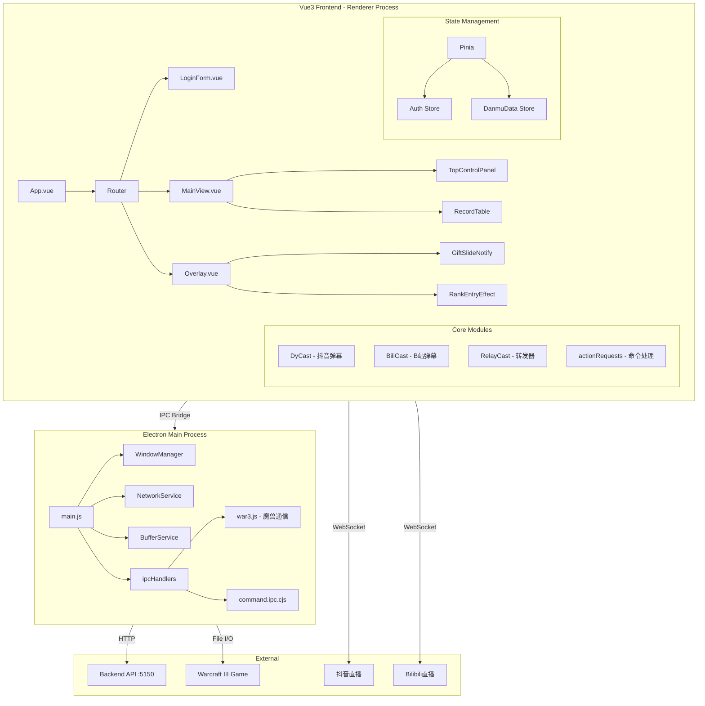
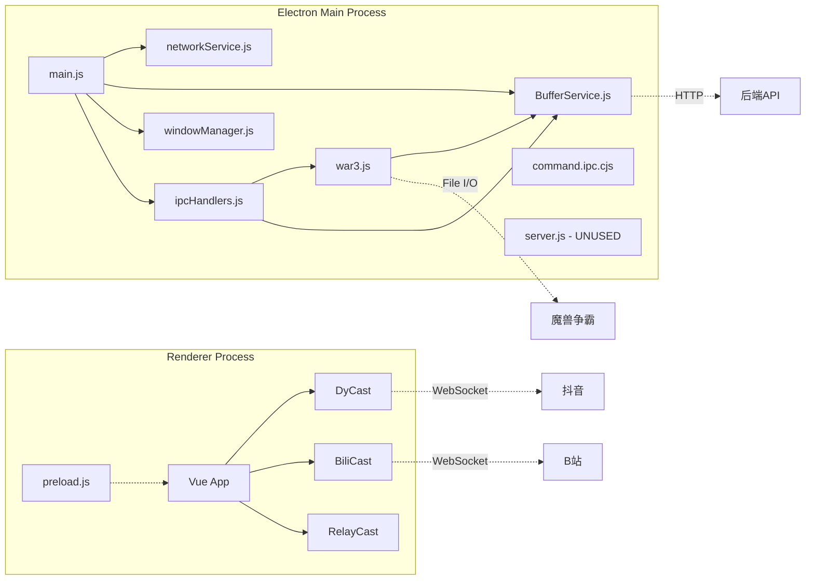

# Electron + Vite + Vue3 + TS 项目结构分析报告

## 一、项目概览

这是一个**直播弹幕互动游戏辅助工具**，核心功能：
- 连接抖音/Bilibili 直播间，接收弹幕/礼物/点赞消息
- 通过 IPC 将消息写入 Warcraft III (魔兽争霸) 的游戏文件，实现弹幕互动
- 提供绿幕叠加层 (Overlay) 窗口，用于直播时显示排行榜、礼物特效
- 配套后端 API (Node.js) 处理用户认证、礼物记录、玩家数据

---

## 二、架构总览



---

## 三、发现的问题与风险

### 🔴 严重问题 (可能导致打包失败或运行时崩溃)

#### 1. [`index.html`](index.html:11) 入口文件指向错误的 JS 路径

```html
<script type="module" src="/src/main.js"></script>
```

- **问题**: 指向的是 `.js` 而非 `.ts` 源文件。Vite 在开发模式下能解析 `.ts`，但 `src/main.ts` 编译后输出为 `dist/assets/index-xxx.js`，这个路径在生产构建中**不存在**。
- **后果**: 生产构建后页面空白，应用无法启动。
- **修复**: 应改为 `/src/main.ts`，Vite 会自动处理。

#### 2. [`package.json`](package.json:5) 中 `"type": "module"` 与 CJS 文件混用

- `package.json` 声明了 `"type": "module"` (ESM)
- 但 [`electron/preload.js`](electron/preload.js:1) 使用 `require('electron')` (CJS)
- [`electron/ipc/command.ipc.cjs`](electron/ipc/command.ipc.cjs:1) 虽然是 `.cjs` 扩展名，但 Electron 的 preload 脚本必须与主进程模块系统一致
- **风险**: Electron 的 preload 脚本在 `contextIsolation: true` 模式下，如果模块系统不匹配可能导致加载失败。

#### 3. [`electron/war3.js`](electron/war3.js:7) 循环依赖

```javascript
import { bufferService } from './services/BufferService.js';
```

而 [`BufferService.js`](electron/services/BufferService.js:165) 末尾：
```javascript
export const bufferService = new BufferService();
```

同时 [`ipcHandlers.js`](electron/ipcHandlers.js) 也依赖 `bufferService`。这种单例导出 + 多处 import 的方式在 ESM 下可能导致**循环引用或未初始化访问**。

#### 4. [`electron/war3.js`](electron/war3.js:229) 中 `launchWarcraft` 函数引用了不存在的路径

```javascript
const loaderDll = path.join(kkweRoot, 'plugin', 'warcraft3', 'yd_loader.dll');
```

但实际目录结构是 [`electron/war3plugin/plugin/`](electron/war3plugin/plugin/)，没有 `warcraft3` 子目录。`yd_loader.dll` 实际位于 [`electron/war3plugin/copyDLL/`](electron/war3plugin/copyDLL/) 中。

#### 5. [`electron/war3.js`](electron/war3.js:45) `writeToWarcraftQueue` 函数守卫逻辑缺陷

```javascript
async function writeToWarcraftQueue(filePath, dataString) {
    if (!filePath) {
        // ... 尝试自动修复
        const autoPath = bufferService.getGamePath();
        if (autoPath) {
            getWarcraftPath(autoPath);
            if (!CommandPath) return;  // 这里 return 了，但 filePath 参数仍然是空的！
        } else {
            return;
        }
    }
    // 继续执行时 filePath 仍然是 null/undefined
    await acquireFileLock(filePath);  // 会报错
```

修复了 `CommandPath` 但没修复 `filePath` 参数，后续代码仍会使用空路径。

---

### 🟠 中等风险 (配置/结构不合理)

#### 6. [`package.json`](package.json:20-29) `build.files` 配置问题

```json
"files": [
    "dist/**",
    "electron/**",
    "node_modules/**",
    "bin/**/*",
    "package.json",
    "!**/*.ts",
    "!**/*.map"
]
```

- `node_modules/**` 会打包**所有**依赖（包括 devDependencies），导致安装包体积巨大
- `electron-builder` 默认会自动处理 `node_modules`，手动指定会覆盖默认行为
- `bin/**/*` 路径不匹配——实际路径是 [`electron/bin/`](electron/bin/)，但打包后 `extraResources` 已经处理了这部分

#### 7. [`electron/server.js`](electron/server.js) 内置 Express 服务器未被使用

- 定义了一个完整的 Express 静态文件服务器，但 [`main.js`](electron/main.js) 中**从未调用** `startServer()`
- 主窗口直接通过 `file://` 协议加载 `dist/index.html`
- 这属于**死代码**，增加维护负担

#### 8. [`electron/windowManager.js`](electron/windowManager.js:33-38) 生产环境自动打开 DevTools

```javascript
this.win.webContents.on('did-frame-finish-load', () => {
    if (!this.win?.webContents.isDevToolsOpened()) {
        this.win?.webContents.openDevTools({ mode: 'detach' });
    }
});
```

这段代码**没有判断开发/生产环境**，生产构建后也会弹出开发者工具，严重影响用户体验。

#### 9. [`electron/networkService.js`](electron/networkService.js:30) 抖音 Cookie 拦截器全局生效

```javascript
session.defaultSession.webRequest.onBeforeSendHeaders(
    { urls: ['https://*.douyin.com/*', 'wss://*.douyin.com/*'] },
    ...
);
```

使用 `session.defaultSession` 会修改**所有窗口**（包括用户可能打开的其他页面）的请求头，存在安全风险。建议使用 `session.fromPartition()` 创建隔离会话。

#### 10. [`src/core/dycast.ts`](src/core/dycast.ts:321-323) WebSocket 地址逻辑缺陷

```typescript
const WS_DOMAIN = import.meta.env.DEV  
    ? 'wss://webcast3-ws-web-hl.douyin.com'
    : location.origin.replace(/^http/, 'ws');
```

生产环境下 `location.origin` 是 `file://` 协议，`replace` 后变成 `file://` 开头的无效 WebSocket 地址。虽然 `_getSocketUrl` 方法中有 fallback 修复，但逻辑分散，容易遗漏。

---

### 🟡 低风险 (代码质量/最佳实践)

#### 11. [`electron/preload.js`](electron/preload.js) 使用 `require` 但项目是 ESM

虽然 Electron 的 preload 脚本有特殊处理，但建议统一使用 `contextBridge` + ESM 风格，或明确使用 `.cjs` 扩展名。

#### 12. [`src/core/actionRequests.ts`](src/core/actionRequests.ts:16) Pinia Store 在模块顶层调用

```typescript
const {addUniquePlay} = useDanmuStore()
```

`useDanmuStore()` 需要在 Vue 组件 setup 或 Pinia 安装后的上下文中调用。在模块顶层调用可能导致**测试困难**和**SSR 兼容性问题**。

#### 13. [`electron/war3.js`](electron/war3.js:537) 进程检测使用概率抽样

```javascript
if (Math.random() > 0.9) { // 没必要每次都查进程，降低频率
```

使用随机数来控制检测频率不可靠，应该使用固定间隔或计数器。

#### 14. [`electron/war3.js`](electron/war3.js:287-312) PowerShell 命令注入风险

```javascript
const csharpCode = `...`;
const psCommand = `$code = '${csharpCode}'; ...`;
exec(`powershell -Command "${psCommand}"`, ...);
```

将 C# 代码嵌入 PowerShell 命令字符串，如果 `targetWidth`/`targetHeight` 等变量包含特殊字符，存在**命令注入风险**。

#### 15. [`package.json`](package.json:7) `appId` 和 `productName` 使用默认值

```json
"appId": "com.example.myapp",
"productName": "MyElectronApp"
```

这些是 electron-builder 的模板默认值，打包后会在系统安装信息中显示，需要修改为实际项目名称。

#### 16. 缺少 TypeScript 配置文件

- 只有 [`tsconfig.app.json`](tsconfig.app.json)（前端用）
- 缺少 Electron 主进程的 `tsconfig.json`（`electron/` 目录下的 JS 文件没有类型检查）
- 缺少根目录 `tsconfig.json`（用于 IDE 支持）

#### 17. [`electron/EverConfig.cfg`](electron/EverConfig.cfg) 配置文件包含敏感路径

```ini
MlScriptFolder = F:\G-drive\YDWE\KKWE插件\cloud
```

暴露了开发者的本地磁盘路径，如果项目开源或分享，存在隐私泄露风险。

#### 18. [`src/api/base.ts`](src/api/base.ts) 和 [`src/api/index.ts`](src/api/index.ts) API 地址不一致

- `base.ts`: 开发环境 `localhost:3000`，生产 `127.0.0.1:3000`
- `index.ts`: 使用 `VITE_API_BASE_URL` 环境变量，默认 `localhost:5150`
- 两个不同的 API 地址，容易混淆

---

## 四、改进建议优先级

### P0 - 必须修复（打包/运行阻断）

| # | 问题 | 建议修复方式 |
|---|------|-------------|
| 1 | `index.html` 入口指向 `main.js` | 改为 `/src/main.ts` |
| 5 | `writeToWarcraftQueue` 守卫逻辑缺陷 | 修复后同时更新 `filePath` 变量 |
| 8 | 生产环境自动打开 DevTools | 添加 `if (process.env.VITE_DEV_SERVER_URL)` 判断 |
| 4 | `loaderDll` 路径错误 | 修正为 `path.join(kkweRoot, 'copyDLL', 'yd_loader.dll')` |

### P1 - 建议修复（影响体验/安全）

| # | 问题 | 建议修复方式 |
|---|------|-------------|
| 6 | `build.files` 配置问题 | 移除 `node_modules/**`，让 electron-builder 自动处理 |
| 9 | 全局 session 拦截 | 使用 `session.fromPartition('douyin-session')` |
| 10 | WebSocket 地址逻辑分散 | 统一在 `_getSocketUrl` 中处理所有情况 |
| 14 | PowerShell 命令注入 | 使用 `child_process.spawn` 传参方式替代字符串拼接 |
| 15 | 默认 appId/productName | 修改为实际项目标识 |

### P2 - 建议优化（代码质量）

| # | 问题 | 建议修复方式 |
|---|------|-------------|
| 7 | 死代码 `server.js` | 移除或明确用途 |
| 12 | Pinia store 顶层调用 | 改为在组件内或工厂函数中调用 |
| 13 | 随机数控制检测频率 | 改为固定间隔计数器 |
| 16 | 缺少主进程 tsconfig | 添加 `tsconfig.electron.json` |
| 17 | 配置文件暴露本地路径 | 清理或使用占位符 |
| 18 | API 地址不一致 | 统一使用环境变量管理 |

---

## 五、模块依赖关系图



---

## 六、总结

该项目整体架构清晰，功能完整，但在以下方面存在**打包隐患**：

1. **构建配置问题**：`index.html` 入口路径错误会导致生产构建后白屏，是最严重的阻断性问题
2. **模块系统混用**：ESM 与 CJS 混用可能导致 Electron 主进程加载异常
3. **路径硬编码**：多处文件路径与实际目录结构不匹配
4. **安全风险**：全局 session 拦截、PowerShell 命令注入
5. **死代码**：Express 服务器未被使用，增加包体积

建议优先修复 P0 级别的 4 个问题，再逐步处理 P1 和 P2 的优化项。
